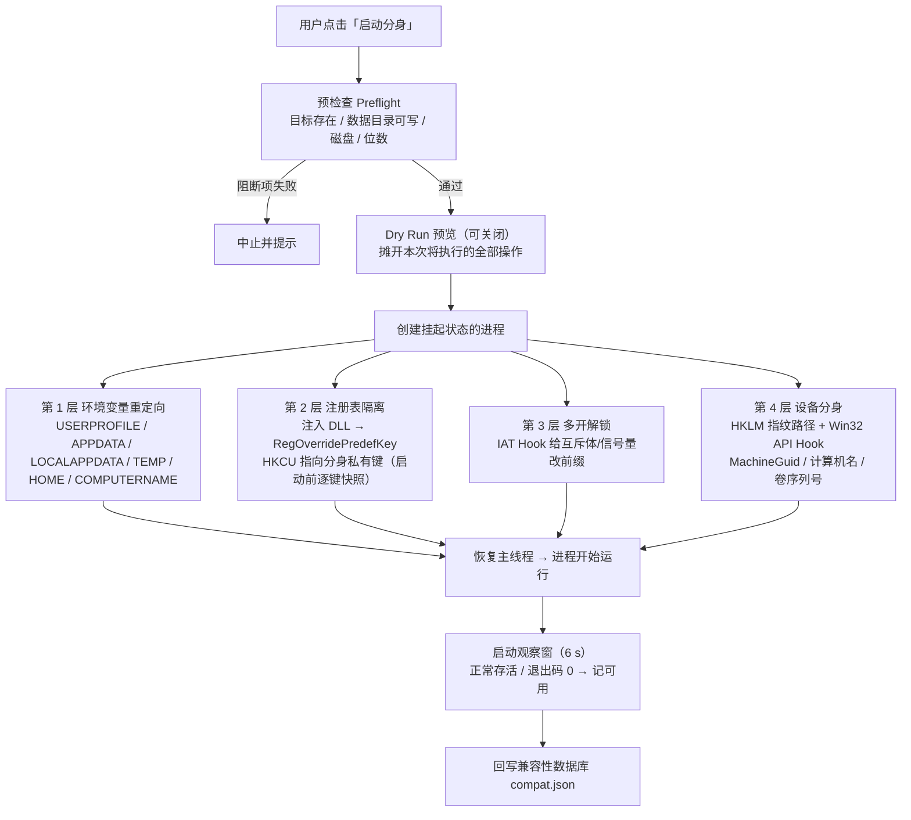

# 应用分身 AppClone

> **电脑版应用分身工具：让同一个应用以多个独立身份同时运行——独立账号、独立数据、
> 独立设备身份，效果对标手机上的"应用分身"。**

[](#) [](#) [](#) [](#) [](#)

双击安装程序即可使用；每个分身拥有独立的登录状态、应用数据与"设备身份"，
像手机一样在电脑上实现一号多开、多号同登。

```
┌──────────────────────────────────────────────────────┐
│ [ICO] 应用分身         [数据目录][＋添加应用][⋯ 更多▾] │
├───────────────┬──────────────────────────────────────┤
│ 我的应用       │  Microsoft Edge                        │
│ ┌───────────┐ │  C:\Program Files (x86)\...\msedge.exe │
│ │ ▣ Edge    │ │  ┌──────────────────────────────────┐ │
│ │ 2 个分身   │ │  │ 分身 1 ● 运行中   [✓ 可用]         │ │
│ ├───────────┤ │  │ [深度隔离] [设备分身]   [启动][管理] │ │
│ │ ▣ 命令提示符│ │  ├──────────────────────────────────┤ │
│ │ 1 个分身   │ │  │ 分身 2 ○ 未运行   [— 未测试]       │ │
│ └───────────┘ │  │ [深度隔离] [设备分身]   [启动][管理] │ │
│               │  └──────────────────────────────────┘ │
│ 每个分身独立的  │                       [＋ 新建分身]     │
│ 登录数据与设备  │                                        │
└───────────────┴──────────────────────────────────────┘
```

## 功能

- **添加应用**：选择任意 `.exe`，自动提取图标与应用名，无需手动配置。
- **新建分身**：为同一应用创建任意数量的分身，每个分身拥有完全独立的一套数据目录与设备身份。
- **启动分身**：一键启动；同一应用的多个分身可同时在线，互不干扰。
- **管理菜单**：每个分身均可执行——
  - 打开数据目录（直接查看/备份该分身的文件）
  - 创建桌面快捷方式（双击直达该分身，免开主程序，**图标带分身角标**）
  - 深度隔离开关 / 设备分身开关（按需增强隔离强度）
  - 结束进程 / 重置分身数据（换一台"新设备"）/ 删除分身
- **分身管理中心**：一张表看住所有应用的所有分身——隔离模式、设备分身、兼容性、运行状态、
  启动次数、累计时长、最后启动，支持四维筛选与行内操作。
- **操作日志**：分级流水 + 结构化崩溃报告，一键导出诊断包发给开发者排查。

### v1.4.1 修复（高 DPI 显示不全）

- **修复 125% / 150% 缩放下大面积「显示不全」**：工程是 PerMonitorV2，点数字体随 DPI 放大，
  而手写像素布局不跟着放大 → 主界面卡片、添加应用列表、安装器提示文字全被裁掉。
  本次统一治理：
  - 全部窗体启用 `AutoScaleMode = Dpi`（构造期整树自动缩放）；
  - 运行期动态创建的 UI（左侧应用卡片、分身卡片、发现页列表、快照卡片、设置主题切换重建、
    主界面主题重建）显式按 `DeviceDpi / 96` 缩放；
  - 设置窗体与安装向导改为全量手动 DPI 换算（存在运行期重建路径，统一口径防打架）；
  - ListView 列宽、`PathSelector` 行高与提示区、徽章尺寸（自测量尺寸，免疫二次缩放）逐项适配；
  - 布局审计探针新增 **150% DPI 仿真**（字体 ×1.5 + 几何 ×1.5 后全量复审），并入 `probe.cmd` 第 4 步。
  涉及：主界面 / 添加应用 / 设置 / 分身管理中心 / 操作日志 / 启动预览 / 快照管理 / 安装向导。

### v1.4.0 新增（F4 / F5 / F6 / F7）

- **分身管理中心（F4）**：跨应用总览表（应用 / 分身 / 序号 / 隔离 / 设备分身 / 兼容性 / 状态 /
  启动次数 / 累计时长 / 最后启动），四维筛选（应用、运行状态、兼容性、关键词搜索），
  行内操作（启动 / 停止 / 打开目录 / 重建 / 删除 / 查看日志）。
  入口：顶栏「⋯ 更多 ▾」下拉与托盘菜单。数据装配层 `Core/CloneOverview.cs` 与 UI 解耦，可被探针断言。
- **日志分级 + 崩溃报告（F5）**：`Debug / Info / Warn / Error` 四级，落盘
  `data\logs\ops-YYYYMMDD.jsonl`（JSON Lines，追加式、单行损坏不牵连全文），保留 **7 天**自动轮转；
  可设最低落盘级别与总开关。崩溃改出结构化报告 `data\logs\crash-<时间戳>.json`
  （版本 / 运行环境 / 最后一条操作 / 堆栈 / 内部异常），旧 `crash.log` 仍留一行摘要兼容。
  **所有删除与回滚操作留痕**（`step="rollback"`）。设置面板新增「日志与诊断」分区，
  可一键**导出诊断包**（日志 + 配置，**不含** `profiles` / `snapshots` 隐私数据）。
- **角标图标（F6）**：桌面快捷方式图标右下角绘制分身序号圆点，颜色取分身角标色，
  输出多尺寸 ICO（16 / 32 / 48 BMP-DIB + 256 PNG）到 `data\icons\`。
  16 px 下圆点太小则不画数字（只给颜色线索），序号 10 以上收敛为「9+」。
  另有**实验性任务栏分组**（AppUserModelID，默认关，失败静默）。
- **文档增补（F7）**：本 README 新增支持应用矩阵、原理流程图、架构表、FAQ、安全说明与 Roadmap。

### v1.3.0 新增（F1 / F2 / F3）

- **兼容性标记**：每个应用与分身都带四态徽章 —— `✓ 可用` / `⚠ 部分` / `✗ 不支持` / `— 未测试`。
  启动一次即自动实测并记录（浏览器内核类应用开箱即判可用、应用商店 UWP 应用直接判不支持）；
  也可在「管理」菜单手动标记，**手动结论优先于自动实测**。记录落在 `data\compat.json`。
- **源应用更新检测**：为每个分身记录创建时的源应用基线（版本号 + 文件时间戳 + 大小）。
  源应用升级 / 被替换 / 路径失联时，右栏顶部出现提示条，可选——
  - **仅更新版本记录**：不动分身数据，只把基线推进到当前版本；
  - **重建分身数据**：先自动存快照再清空数据；分身名称、角标颜色、热键与**设备身份全部保留**。
- **启动预览 Dry Run（默认开启）**：启动前摊开本次将执行的全部操作 —— 环境变量重定向映射、
  注册表私有键路径、注入组件、假设备身份、内核附加参数。确认后才真正启动，
  也可勾选「以后不再显示」一次关掉（设置面板可重新开启）。
- **启动前预检查**：磁盘剩余空间、注入组件位数是否与目标程序匹配、目标程序是否存在、
  数据目录可写性、权限提示。其中「目标程序不存在」「数据目录不可写」为阻断项，直接拦下启动；
  其余为警告与提示，仍可继续。

## 支持应用矩阵

矩阵由兼容性数据库的实际记录导出，可随实测持续更新。**表内为经验值，非承诺**：
最终结论以你自己机器上的实测徽章为准（`✓` / `⚠` / `✗` / `—`）。

| 类别 | 代表应用 | 预期 | 说明 |
|---|---|---|---|
| Chromium 内核 | Edge / Chrome / Brave / 微信内置浏览器 | ✅ 可用 | 自动附加 `--user-data-dir`，走官方多实例通道 |
| Gecko 内核 | Firefox / 水狐 | ✅ 可用 | 自动附加 `-profile` + `-no-remote` |
| 即时通讯 | 微信 / QQ / Telegram / Discord / 钉钉 | ✅ 可用 | 数据目录在用户目录下，环境变量重定向即覆盖；多开需深度隔离 |
| 开发工具 | VS Code / Trae / 各类 Electron 应用 | ✅ 可用 | Electron 同 Chromium，用户数据目录可重定向 |
| 游戏平台 | Steam / Epic | ⚠ 部分 | 平台本体可多开，但同一账号同时在线受服务端限制 |
| 混合沙盒 / 内核反调 | Arc 类浏览器 | ⚠ 部分 | 自带沙盒可能与注册表重定向冲突，建议关闭深度隔离试 |
| UWP / 应用商店应用 | 从「Microsoft Store」安装的应用 | ✗ 不支持 | 受 AppContainer 限制，无法注入与重定向 |
| 硬编码绝对路径 | 数据写在固定盘符路径、或服务型进程 | ✗ 不支持 | 无驱动用户态沙盒的普遍限制，见「已知边界」 |
| 反作弊内核驱动 | 部分网游 / 竞技游戏 | ✗ 不支持 | 驱动级保护会拒绝被注入的进程 |

> 想为某个应用补一条结论？在「管理」菜单里手动标记即可，记录会写进 `data\compat.json`，
> 也会出现在诊断包里。

## 适用场景

- 同一软件的**多账号同时登录**（如多个工作号、游戏小号）。
- 需要为某应用构造**独立设备指纹**以应对"单设备"类限制。
- 在**不污染本机真实环境**的前提下试用、隔离运行各类桌面程序。

## 隔离原理（四层叠加）



| 层级 | 手段 | 隔离内容 |
|------|------|----------|
| 1. 环境变量重定向 | 启动时重写 `USERPROFILE` / `APPDATA` / `LOCALAPPDATA` / `TEMP` / `HOME` / `COMPUTERNAME` | 用户目录下的全部运行数据、配置、缓存 |
| 2. 注册表隔离 | 注入 sandbox DLL，用 `RegOverridePredefKey` 把进程内 `HKCU` 指向分身私有键（启动前逐键快照真实 HKCU） | 登录凭据、应用配置（深度隔离） |
| 3. 多开解锁 | 同一 DLL 通过 IAT Hook 给命名互斥体/信号量改前缀，让每个分身都认为自己是"第一个实例" | 绕过单实例限制（深度隔离） |
| 4. 设备分身 | HKLM 指纹路径（`MachineGuid` / `ProductId` / 计算机名 / 主机名 / BIOS 序列号 / SQM MachineId）重定向到分身私有假设备数据；Hook `GetComputerName(/Ex)`、`GetVolumeInformation`、`UuidCreateSequential`；`LoadLibrary` 后对新加载模块重新打补丁 | 每个分身呈现为**一台独立设备**，绕过"同一设备"类限制（如 Trae 的设备签到） |

对 Chromium 内核应用自动附加 `--user-data-dir`、Firefox 自动附加 `-profile + -no-remote`，
走官方多实例通道。假设备数据在首次启动时生成并持久化——同一分身永远是同一台"设备"，
删除分身或"重置分身数据"即换一台新"设备"。

## Architecture

`src/AppClone/Core/` 是 20+ 个职责单一的原子类，`MainForm.cs` 是唯一的 UI 编排点。
本轮新增的三个类刻意做成"可被探针断言"的纯逻辑层：

| 类 | 职责 | 关键 API |
|---|---|---|
| `Store` | 应用与分身的唯一持久化（`data\apps.json`） | `AddClone` / `RemoveClone` / `BatchAddClones` |
| `Launcher` | 建目录 → 建挂起进程 → 注入 → 恢复 | `Launch` / `Describe` / `IsRunning` / `Stop` |
| `Injector` | 注入入口（**隔离核心，冻结**） | `Inject` |
| `RegClone` | 注册表私有键快照与 `RegOverridePredefKey`（**冻结**） | `EnsureSnapshot` / `ResetCloneRegistry` |
| `Snapshot` | 分身数据快照创建 / 恢复 / 删除 | `Create` / `Restore` / `Delete` |
| `CloneStats` | 启动次数 / 累计秒数 / 最后启动（`stats.json`） | `Get` / `MarkLaunched` |
| `CompatibilityDb` | 兼容性推断 + 自学习 + 用户标记（`compat.json`） | `Resolve` / `Report` |
| `SourceWatch` | 源应用基线打标与变化检测 | `Check` / `Stamp` |
| `Preflight` | 启动前预检查 + PE 位数识别 | `Check` / `Format` |
| `LaunchWatch` | 启动 6 秒观察窗，回写兼容性 | `Begin` |
| **`CloneOverview`** | **管理中心数据装配（F4）** | `Build` / `Filter` / 列文案助手 |
| **`Log`** | **分级日志 / 崩溃报告 / 诊断包（F5）** | `Info` / `Warn` / `Error` / `Rollback` / `WriteCrashReport` / `ExportDiagnostics` |
| **`BadgeIcon`** | **多尺寸 ICO 角标图标（F6）** | `Build` / `Ensure` |
| `Paths` / `Settings` / `Theme` / `Ui` | 路径 / 设置 / 主题 / 控件工厂 | — |
| `AppDiscovery` / `AppIcons` / `AppClassifier` | 应用发现 / 图标提取 / 分类推荐 | — |
| `TrayContext` / `HotkeyManager` / `AutoStart` | 托盘 / 热键 / 自启 | — |

## FAQ

**Q：为什么有些应用分身不成功？**
A：三类原因最常见——① 应用把数据写到**硬编码的绝对路径**（无驱动用户态沙盒的普遍限制）；
② 应用是 **UWP / 应用商店**分发，受 AppContainer 限制无法注入；③ 应用带**内核级反作弊驱动**，
会拒绝被注入的进程。三者都会在兼容性徽章上体现为 `✗`。

**Q：为什么会被杀毒软件误报？**
A：本工具的工作方式包含「给另一个进程注入 DLL」与「Hook 系统 API」——这正是杀软高度敏感的行为模式，
**与恶意软件的某些技术手段同源**。但我们只做隔离与重定向，不联网、不窃取、不修改目标应用本体。
若被拦截，请将 `dist\sandbox\inject64.dll` / `inject32.dll` 加入信任白名单。
详见下方「Security Notes」。

**Q：为什么单实例限制没有被破解？**
A：单实例靠命名互斥体/信号量实现，本工具通过 IAT Hook 给这些名字加前缀（第 3 层）。
若没生效，常见原因是：**未开启「深度隔离」**（该层属于深度隔离），
或应用绕过了 Win32 API 直接走 `ntdll`（不在 Hook 覆盖范围）。

**Q：为什么第一次启动比较慢？**
A：首次启动要做三件一次性的事——① 生成该分身的假设备身份并持久化；
② 逐键快照真实 HKCU 到私有键；③（应用首次运行时）它自己在建初始数据目录。
之后同一分身再启动就快了。

**Q：日志在哪？会上传吗？**
A：`data\logs\`。**不会上传**——本工具没有任何联网上报。只有你主动点「导出诊断包」才会把日志打包成 zip，
由你自己决定发给谁。

**Q：能同时开几个分身？**
A：没有硬性上限（批量新建上限 99 个/次）。真正的限制是你的**磁盘与内存**，
以及部分应用服务端的**同设备并发登录策略**。

**Q：主程序开着的时候，双击分身快捷方式还能启动吗？**
A：**能**。无头启动（`--launch`）不参与 GUI 的单实例保护 ——
否则「免开主程序直达」这个卖点会在主窗口开着时直接失效。连点两个分身的快捷方式也是各起各的。
（此项在 v1.4.0 的全量 QA 中修复，此前 `--launch` 会被主实例互斥体拦下并弹框。）

**Q：安装时想装到 D 盘，怎么选最快？**
A：点安装向导里的「**浏览…**」——它唤起的是 Windows 原生文件夹选择器（不是老式的小树控件），
**顶部地址栏可以直接粘贴 `D:\应用分身` 回车直达**，左侧能展开所有盘符，也能当场新建文件夹；
而且打开时就落在当前路径最近一个存在的目录上，不会每次都弹回「此电脑」。
想更省事就点「**快速定位 ▾**」：默认位置 / 上次装的位置 / 桌面 / 文档，
以及**每个盘符的 `X:\应用分身`**（带可用空间）一键跳。
路径框还支持从资源管理器**拖入文件夹**，按**回车**即开始安装。
装过一次之后安装位置会被记住，下次打开直接落在那儿。

## Security Notes

本工具的注入组件（`dist\sandbox\inject64.dll` / `inject32.dll`，源码 `src/sandbox_dll/fenshen.c`）**做**：

- 用 `RegOverridePredefKey` 把**目标进程**的 `HKCU` 重定向到本工具的私有键；
- 给**目标进程**内的命名互斥体/信号量加前缀；
- Hook 若干 Win32 API，返回分身私有的假设备指纹。

**不做**：

- ❌ 不联网、不上报任何数据；
- ❌ 不读写目标应用的文件本体（不复制、不修改、不重签名）；
- ❌ 不修改系统 HKLM / 真实 HKCU 的值（只在自己的私有键下工作）；
- ❌ 不 Hook 其他进程，注入只发生在**你主动启动的那个分身进程**里；
- ❌ 不请求管理员权限（若无权限，深度隔离自动降级为标准隔离并告警）。

## 安装与运行

1. 获取安装程序 `AppClone-Setup.exe`（见下方"构建"一节，由仓库脚本一键生成）。
2. 双击运行安装向导：选择安装位置 → 自动创建开始菜单 / 桌面快捷方式 →
   支持在系统"设置 - 应用"中卸载。
3. 打开「应用分身」，点击 **＋添加应用** 选择目标 `.exe`，再为每个应用 **新建分身** 即可。

**安装位置怎么选最快：**

| 方式 | 操作 |
|---|---|
| **浏览…** | 唤起 Windows 原生文件夹选择器（资源管理器那套）。顶部地址栏可直接粘贴 `D:\应用分身` 回车直达，左侧导航树可展开所有盘符，也能当场「新建文件夹」。**打开时就落在当前路径最近一个存在的目录**（而不是每次都弹在「此电脑」）。 |
| **快速定位 ▾** | 一键跳到：默认位置 / 上次安装的位置 / 桌面 / 文档 / 用户程序目录，以及**每个本机盘符的 `X:\应用分身`**（带可用空间）。 |
| 直接输入 | 在路径框里手打或 Ctrl+V 粘贴均可。 |
| 拖放 | 把文件夹从资源管理器直接拖到路径框上。 |
| 回车 | 路径框里按回车＝点「开始安装」。 |

> 路径行下方会**实时校验**：非法字符、相对路径、不存在的盘符、盘符根目录、需要提权的
> `Program Files`、以及**该位置是否已装过旧版本**，都会当场给一句人话提示。
> 上次安装到哪会被记住（`HKCU\Software\FenShen\AppCloneSetup`），下次打开直接落在那儿。

> 说明：主仓库为**纯源码仓库**，不提交任何编译产物或安装包二进制。
> 安装程序 / 便携版由构建脚本从源码生成到本地 `dist/` 目录（该目录已加入 `.gitignore`）。

## 目录结构

```
D:\fenshen\
├── .gitignore                  忽略 bin/obj/dist/*.dll/*.exe/*.pdb 等构建产物
├── dist\                       【本地生成，不进 git】发行产物目录
│   ├── AppClone.exe            便携版主程序（build.cmd 生成）
│   ├── AppClone-Setup.exe      安装程序（内嵌全部文件，由 build_installer.cmd 生成）
│   └── sandbox\                沙盒组件（inject64/inject32/selftest/devprobe）
├── assets\                     软件图标源文件（icon_gen.py 可重新生成）
├── src\
│   ├── AppClone\               主程序（C# WinForms / .NET 10）
│   │   ├── Core\               20+ 原子类（含 CloneOverview / Log / BadgeIcon）
│   │   ├── Forms\              SettingsForm / SnapshotsForm / DryRunForm / CloneManagerForm / LogViewerForm
│   │   └── MainForm.cs         唯一 UI 编排点
│   ├── AppClone.Setup\         安装程序（向导 + 卸载器，内嵌 payload）
│   │   ├── PathSelector.cs     安装位置选择行（手算布局 + 拖放 + 实时校验 + 快速定位）
│   │   └── FolderPicker.cs     原生「选择文件夹」对话框（IFileOpenDialog + FOS_PICKFOLDERS）
│   ├── Shared\Shortcuts.cs     原生 .lnk 快捷方式（IShellLink + AppUserModelID）
│   └── sandbox_dll\fenshen.c   沙盒 DLL（注册表隔离 + 多开解锁 + 设备分身）
├── scripts\
│   ├── build.cmd               一键构建（沙盒 DLL + 主程序便携版 → dist\）
│   ├── build_installer.cmd     一键打包安装程序 → dist\AppClone-Setup.exe
│   ├── pack_payload.ps1        将主程序与沙盒组件打包为安装器载荷
│   ├── probe.cmd               逻辑回归探针（编译主程序 + 核心 86 项 + 安装器 UI 77 项断言）
│   ├── qa.cmd                  一键全量 QA（编译 → 核心探针 86 → 安装器 UI 探针 77 → 便携版 → 安装程序）
│   └── test.sh                 隔离能力自动化测试（15 项断言）
├── test\probe\                 F1–F6 逻辑回归探针（引用编译产物断言，数据目录重定向到临时目录）
├── test\setup-ui\              安装器 UI 探针（复用安装器源码，只断言几何与文案，不创建窗口）
├── test\ui-audit\              全窗体布局审计探针（多宽度遍历控件树，检测越界 / 重叠 / 文本溢出）
├── docs\                       增量交付记录 / 评审映射 / 架构设计 / 时序图
└── README.md
```

> 运行时数据在 **exe 同目录的 `data\`** 下生成（便携版即 `dist\data\`）：
> `apps.json`（应用与分身）、`settings.json`、`stats.json`（运行统计）、`compat.json`（兼容性记录）、
> `logs\`（分级日志与崩溃报告）、`profiles\`（各分身数据）、`icons\`（角标图标）、`snapshots\`。
> 可用环境变量 `FENSHEN_DATA_DIR` 重定向。

## 构建（从源码）

依赖：

- [.NET 10 SDK](https://dotnet.microsoft.com/download)
- Visual Studio 2022（含 MSVC 桌面开发负载，用于编译沙盒 DLL）

```cmd
scripts\build.cmd              :: 编译沙盒 DLL + 生成主程序便携版 AppClone.exe 到 dist\
scripts\build_installer.cmd    :: 打包并生成安装程序 dist\AppClone-Setup.exe
scripts\probe.cmd              :: 编译主程序 + 跑两套探针（核心 86 项 + 安装器 UI 77 项，退出码 0 = 全过）
scripts\qa.cmd                 :: 一键全量 QA（上面两套探针 + 两个成品构建串起来跑，退出码 0 = 全过）
bash scripts\test.sh           :: 运行隔离能力自动化测试
```

完成构建后，`dist\AppClone-Setup.exe` 即为可分发的安装程序；便携版 `dist\AppClone.exe`
可独立运行，无需安装。

## 验证结果（`scripts/test.sh`，15 项断言全部通过）

> 本轮 v1.4.0 全量 QA 中**实跑**（`bash scripts/test.sh` → `15 通过, 0 失败`，退出码 0）。
> 过程中挖出并修复了两个缺陷：① 无头启动被 GUI 单实例互斥体拦下（产品缺陷，主程序开着时快捷方式失效）；
> ② 测试脚本把 POSIX 路径直传给原生 exe。详见 `docs/incremental-1.4.0-2026-09-21.md` 第 7.5 节。

- ✅ 环境变量隔离：分身内 `USERPROFILE`/`APPDATA`/`TEMP` 全部指向分身目录
- ✅ 注册表隔离：分身读写均落在私有键，真实 HKCU 不受污染，跨启动持久化
- ✅ 多开解锁：两个分身同时启动均通过单实例互斥体检查（对照组未注入时报 SECOND）
- ✅ 设备分身：两个分身的 MachineGuid / 设备名 / 卷序列号互不相同；同一分身跨启动稳定；
  与真实设备不同；真实 HKLM 未被修改；延迟加载的原生模块同样读到假设备 ID
- ✅ GUI 实测：图标提取、启动/运行状态、快捷方式、卸载登记全链路验证

### 逻辑回归探针（`scripts/probe.cmd`，核心 86 项 + 安装器 UI 77 项，全部通过）

覆盖 v1.3.0 / v1.4.0 新增能力，直接引用编译产物断言真实行为，数据目录重定向到临时目录（不触碰真实数据）：

- ✅ **兼容性数据库**：内置推断（浏览器内核 → 可用 / UWP → 不支持）、自学习状态机
  （成功 → 可用；单次失败 → 部分；连续 3 次失败 → 不支持）、**用户手动标记不被自学习覆盖**、
  枚举以可读字符串持久化、Reset 回退
- ✅ **源应用监视**：基线打标 → 无变化不报警、文件被替换 → `ExeReplaced`、路径丢失 → `PathMissing`、
  **无基线的老数据 → `Unknown`（不误报升级）**
- ✅ **预检查**：PE 位数识别（32/64 位真实系统文件双向验证）、缺失目标程序判为阻断项
- ✅ **Dry Run 数据源**：环境变量 ≥ 9 项且 `USERPROFILE` 指向分身 home、深度隔离写入 `FENSHEN_REG_SUBKEY`、
  `FENSHEN_MUTEX_TAG` = cloneId 前 12 位、步骤含注入与进程树说明
- ✅ **管理中心（F4）**：`Build` 行数与联表正确、四维筛选（应用 / 状态 / 兼容性 / 搜索）、
  列文案与时长格式化
- ✅ **日志与崩溃报告（F5）**：级别过滤（低于下限不落盘）、总开关关闭后完全不写流水但**仍更新内存最后操作**、
  结构化崩溃报告含版本/最后操作/堆栈、旧 `crash.log` 兼容追加、诊断包含 `summary.txt` 与当日流水且
  **不含 profiles / snapshots**
- ✅ **角标图标（F6）**：4 帧 ICO 结构自洽、**系统 `Icon` 解析器可读并取到 16×16 / 32×32**、
  256 帧 PNG 内嵌、16 帧 BMP-DIB（`biSize=40` / `biHeight` 双倍）、序号 >9 收敛分支、
  `Ensure` 命中缓存不重复绘制、源程序不存在时返回 `null`
- ✅ **数据向后兼容**：v1.2.0 老 `apps.json`（无新字段）载入后应用/分身不丢、新字段取默认值

**安装器 UI 探针（`test/setup-ui`，77 项）**——直接复用安装程序源码编译，全程不创建窗口句柄：

- ✅ **路径行几何**：在 320 / 512 / 640 / 900 / 1400 五种宽度下，输入框、「浏览…」、「快速定位 ▾」
  三列**互不重叠、不越出容器、同一行等高**；含一条**防 Anchor 回流**的回归守卫
  （老写法用 `Anchor=Right` + 构造期 200 宽的宿主，右间距会被算成负数，输入框撑到 860px 直接盖住按钮）
- ✅ **路径校验文案**：空路径 / 非法字符 / 相对路径 / 不存在的盘符 / 盘符根目录 /
  受保护的 `Program Files` / 目录已存在 / 已装过旧版本，八种情形分别给出对应提示
- ✅ **快速定位候选**：默认位置与盘符项齐全、全部为绝对路径、盘符项落在本盘符下且以应用名结尾、
  标注可用空间；「上次使用」可用才收录、与默认或当前路径重复时不罗列、已失效则不收录
- ✅ **选择器初始目录回溯**：空值返回 `null`、深层不存在路径回溯到最近存在的祖先、
  拖入文件时回溯到其所在目录、相对路径返回 `null`

## 已知边界

- 深度隔离的注册表快照在创建分身那一刻复制，之后分身与主环境各自演化（可"重置分身数据"）。
- 应用把数据写到硬编码的绝对路径时无法重定向（无驱动用户态沙盒的普遍限制）。
- 设备分身覆盖注册表与 Win32 API 层指纹；MAC 地址（`GetAdaptersAddresses`）与
  SMBIOS 硬件 UUID（`GetSystemFirmwareTable`）暂未伪造，可按需扩展。
- 应用若绕过 Win32 注册表 API 直接走 ntdll，或在子进程中读取指纹，不在 Hook 覆盖范围。
- 兼容性自学习的观察窗为 **6 秒**：应用启动后 6 秒内异常退出会被记为「部分可用」；
  已用「Job Object 存活 + 退出码」二次确认降低误判，但用户主动结束（无论方式）均已排除在判定之外。
- 兼容性结论按 **exe 文件名** 归档，因此同一应用的不同版本共享一条记录。
- 桌面快捷方式直达（`--launch` 无头模式）不参与兼容性自学习——该进程启动后即退出，无法携带观察线程；
  经主界面 / 热键启动的分身才会记录。
- 源应用基线只覆盖「版本号 / 文件时间戳 / 文件大小」三项；应用自身在运行期静默热更新自身数据、
  且不改动主程序文件时，不会被检测到。
- 操作日志保留 **7 天**后自动清理；诊断包**不含**分身数据目录与快照（隐私边界）。
- 任务栏分组（AppUserModelID）为**实验性**，各大 Windows 版本行为不一，默认关闭且失败静默。

## Roadmap

| 项 | 内容 | 状态 |
|---|---|---|
| F1 兼容性数据库 + 四态徽章 | 内置推断 + 自学习 + 用户标记 | ✅ v1.3.0 |
| F2 源应用更新检测 + 一键重建 | 基线三元组 + 升级提示条 + 保留分身身份重建 | ✅ v1.3.0 |
| F3 预检查 + Dry Run | 阻断级检查 + 启动预览 | ✅ v1.3.0 |
| F4 克隆管理中心 | 跨应用总览 + 四维筛选 + 行内操作 | ✅ v1.4.0 |
| F5 日志分级 + 结构化崩溃报告 | JSONL 流水 + 崩溃报告 + 诊断包 | ✅ v1.4.0 |
| F6 角标图标 | 多尺寸 ICO + 实验性任务栏分组 | ✅ v1.4.0 |
| F7 README / docs 增补 | 支持矩阵 / 原理图 / 架构 / FAQ / Roadmap | ✅ v1.4.0 |
| — | `MainForm` 拆分（`CloneMenuController` / `RightPaneBuilder`） | 计划中 |
| — | 设备分身扩展：MAC 地址 / SMBIOS UUID 伪造 | 计划中 |
| — | 兼容性数据库云同步 / 社区共享 | 探索中 |

## 许可

仅供学习与个人本地使用；请遵守你所分身之应用的服务条款。
